# xordock

**Your files, split into two halves. Each half on its own is random noise.**

xordock is a macOS app that gives you an ordinary folder in Finder. Everything you put there is split with XOR into two shares: **share A** stays on your Mac, **share B** lives on a removable SD card or USB stick. Pull the card out and there is nothing on the Mac to read. Lose the card and the finder holds noise. Put the card back and the folder is there again.

```
   your file M ──┐
                 ├─► A = M ⊕ R  ──► Mac (SSD)          + copy in iCloud Drive
   random mask R ┴─► B = R      ──► working card       + copy on a spare card

   M = A ⊕ B   (only with both halves)
```

> **Honest status:** xordock implements the one-time-pad construction, whose secrecy is *provable* and does not depend on P vs NP, **only if the masks are truly random**. Today the masks come from the macOS CSPRNG, so the protection xordock actually delivers is **practical (computational), with NO information-theoretic guarantee and no resistance to P = NP**. What is missing to close that gap is described below, in [What it takes](#what-it-takes-hardware-and-generator).

### Two levels of protection

| Where the masks come from | Protection | Depends on P vs NP? |
|---|---|---|
| **Kernel API** (`SecRandomCopyBytes` → kernel DRBG). **This is what xordock does today.** | **Practical (computational) protection.** Strong in practice, but it rests on the assumption that the DRBG cannot be predicted. | Yes: no resistance to P = NP. |
| **Hardware generator read directly** (a physical TRNG/QRNG whose full-entropy output goes straight into the mask, *not* through the kernel's DRBG), with conditions 2–4 below met | **Information-theoretic protection** (perfect secrecy of each share). | No: secure whether or not P = NP. |

The step from the first row to the second changes only the **mask source**. The XOR split, the block layout and the rule "keep A and B apart" stay the same. Apple Silicon Macs do not let apps read their built-in hardware generator directly, so the second row needs an external hardware generator (or an Intel Mac with `RDSEED`); see [What it takes](#what-it-takes-hardware-and-generator).

## Why this is different from ordinary encryption

AES, RSA, elliptic curves: almost all file encryption is secure *because* certain problems are believed to be hard to compute. Nobody has proven that. If P = NP turned out to be true with a practical algorithm, or someone found a shortcut for one specific cipher, data encrypted today could be read tomorrow. And attackers can store ciphertext now and wait.

The **one-time pad** (Vernam cipher, 1917; proven by Shannon in 1949) is the one cipher whose security is a mathematical fact, not an assumption: the key is as long as the data, truly random and used once. No amount of computing power helps, because there is nothing to compute. Every possible file is equally consistent with what the attacker sees. P vs NP is irrelevant to it: the scheme does not *solve* P = NP, it simply does not depend on the answer.

xordock uses exactly this construction as a **2-of-2 secret split**: the mask R is the one-time key, A is the ciphertext, and the two are stored on different devices. Each block (1 MiB) gets its own fresh mask, every write creates a new block with a new mask, and no mask is ever reused.

## The proof

Let the file block be an `n`-bit string `M` with any distribution. Let the mask `R` be **uniformly random over {0,1}ⁿ and independent of `M`**. The shares are `A = M ⊕ R` and `B = R`.

**Share B alone.** `B = R` is chosen independently of `M`, so `P(M = m | B = b) = P(M = m)`. B carries no information about M.

**Share A alone.** For any value `a` and any file `m`:

```
P(A = a | M = m) = P(m ⊕ R = a) = P(R = a ⊕ m) = 2⁻ⁿ
```

This does not depend on `m`, so `A` is independent of `M`. By Bayes:

```
P(M = m | A = a) = P(A = a | M = m) · P(M = m) / P(A = a) = 2⁻ⁿ · P(M = m) / 2⁻ⁿ = P(M = m)
```

Seeing A does not change the attacker's knowledge of M at all. This is Shannon's **perfect secrecy**. It holds against an adversary with unbounded time and computing power, so it holds whether or not P = NP, and also against quantum computers.

**Both shares.** `A ⊕ B = M ⊕ R ⊕ R = M`. Whoever holds both has the file. That is the whole security model: **keep A and B apart.**

### What the proof does not cover

- **Length.** The size of each block and the number of blocks leak, so the approximate size of the vault is visible.
- **Integrity.** XOR is malleable: flipping a bit in A flips the same bit in M. Each share carries a SHA-256 checksum that catches accidental damage, not a deliberate forger who controls a share.
- **The open vault.** While mounted, files are plaintext on the Mac (RAM, app caches, temporary files). FileVault and unmounting matter.
- **Copies.** Any A from one time + the B from the same time = the file. Old copies of A (SSD, iCloud, Time Machine) and of B (spare card) count too.

## What it takes: hardware and generator

The proof needs four conditions. Here is each one and where xordock stands today.

| # | Condition | Required | xordock today |
|---|---|---|---|
| 1 | Truly random mask | Full-entropy output from a **physical** noise source (thermal/shot noise, quantum effects), with continuous health tests (NIST SP 800-90B: repetition count, adaptive proportion). **Not** a seeded deterministic generator: its output is only computationally indistinguishable from random. | ✗ Masks come from `SecRandomCopyBytes`, a DRBG seeded by hardware entropy. This gives practical protection only. |
| 2 | Key as long as the data, never reused | One mask bit per data bit; new mask for every write. | ✓ 1 MiB blocks, fresh mask per immutable block, copy-on-write. |
| 3 | Shares on separate devices | A and B never on the same physical medium or in the same account. | ◐ Volumes are checked, physical disks are not yet (S006): a disk image or a second partition on the same disk would pass. |
| 4 | The mask is never stored elsewhere | B exists only on the cards; the mask is not logged or cached. | ✓ Masks go straight into share B; buffers are wiped; nothing is logged. |

### The generator: what Macs offer

- **Apple Silicon (MacBook, Mac mini, iMac with M1–M4).** The chip *has* a hardware random source. The macOS kernel samples it and runs SP 800-90B health tests on it (`sysctl kern.entropy.*`). But apps only ever get the output of a DRBG seeded from it: `SecRandomCopyBytes`, `getentropy`, `/dev/random`. There is no public API for raw hardware bits, and M1 Pro has no ARM `RNDR`/`RNDRRS` instructions (`FEAT_RNG` absent). **Built-in hardware cannot satisfy condition 1 on Apple Silicon.**
- **Intel Mac (e.g. Mac mini 2018).** The CPU offers `RDSEED`, callable from an app, which returns conditioned output of Intel's on-chip entropy source rather than DRBG-expanded output. It is the closest a Mac gets to a built-in TRNG, at the cost of trusting a closed Intel design.
- **External hardware TRNG or QRNG (USB).** Works with any Mac. Choose a device with a documented physical noise source, on-device health tests and full-entropy output (ideally an SP 800-90B validated entropy source). The throughput must cover the data rate: **every byte written to the vault consumes one random byte**, so 1 GB of files needs 1 GB of entropy.

To make the claim, xordock would need a mask-source adapter for such a device (the `split.MaskSource` interface already isolates it): health tests at runtime, refusal to write when the source fails, a throughput test and an independent cryptographic review. Until then, the product claim stays "practical protection" (gates S004 CG-14 and SC-07).

### Storage hardware

- A Mac with macOS 26+ and **FileVault on** (share A and the open vault live there).
- **Two removable media** for B: a working card and a spare card. SD cards or USB sticks, formatted APFS or Mac OS Extended (exFAT/FAT survive sudden removal worse). USB 3 is strongly recommended: a USB 2 stick writes about 3.7 MB/s.
- **iCloud Drive** for the copy of share A, protected with 2FA and preferably Advanced Data Protection.
- **macFUSE 5.5+** with its file system extension enabled (the app checks this at launch).

## Who loses what, and what happens

The rule behind every row: **any copy of A + the matching copy of B = your files.** A lives on the Mac, in iCloud Drive and possibly in Time Machine. B lives on the working card and the spare card.

### Losing one thing

| Lost or stolen | What the finder gets | Your data | What to do |
|---|---|---|---|
| **Working card** | Only B: noise. | Safe: A (Mac) + spare card. | `Recovery…` → restore to a new card with **new masks**. Then delete every copy of the old A (SSD, iCloud Drive incl. Recently Deleted, Time Machine), because the lost card + any old A = the files. |
| **Spare card** | Only a copy of B. | Nothing lost. | Make a new backup to another card. Rotate as above (restore with new masks, delete old A copies), since the spare + iCloud A would be a full set. |
| **Mac (SSD)** | A, protected by FileVault while the Mac is locked or off. Without a card: nothing. | Safe: iCloud A + spare or working card. | On the new Mac the app lists "Share A copies in iCloud without SSD" → `Recovery…`. Change the Apple ID password, since the Mac may be signed in to iCloud. |
| **iCloud account** (taken over) | The copy of A. Without a card: nothing. | Safe. | Secure the account, then rotate: restore with new masks and delete old A copies. |

### Losing two things

| Lost together | Confidentiality | Your data |
|---|---|---|
| Mac + working card (e.g. a bag with the card in the port) | **Exposed** if the attacker gets past FileVault (Mac unlocked or password known). | Safe: iCloud A + spare card. |
| Mac + spare card | **Exposed** under the same FileVault condition. | Safe: iCloud A + working card. |
| Working card + iCloud account | **Exposed**: the attacker has A and B. | Safe: Mac + spare card. Rotate immediately. |
| Both cards | Safe: no B anywhere. | **Lost**: A alone cannot be decoded. |
| Mac + iCloud account | Safe: no B. | **Lost**, unless a Time Machine copy of A exists. |

So: **never carry the cards together, never keep a card in the Mac when the vault is closed, never put a card's contents in iCloud or on the Time Machine disk.**

## How to use it

### Install and start

1. Install [macFUSE](https://macfuse.github.io/) 5.5+ and enable it in System Settings → General → Login Items & Extensions → File System Extensions.
2. Build and start the app:
   ```bash
   ./scripts/build-app.sh
   open build/xordock.app
   ```
3. At launch the app checks the requirements (macOS, macFUSE, the extension via a one-second probe mount, FileVault, iCloud Drive) and shows what to fix. It then offers a **tutorial**: six short screens explaining the idea, then a guided walkthrough on your real vault. You can turn the prompt off in Settings (⌘,).

### Tutorial: your first vault, step by step

The screenshots below come from a real run: a vault called `sejf`, two USB sticks named `xor_primary` (working card) and `xor_backup` (spare card), macOS 27 on an M1 Pro.

**1. The introduction.** On first launch the app explains the idea in six screens. Click **Next** through them, or **Skip introduction**.

| | |
|:---:|:---:|
| 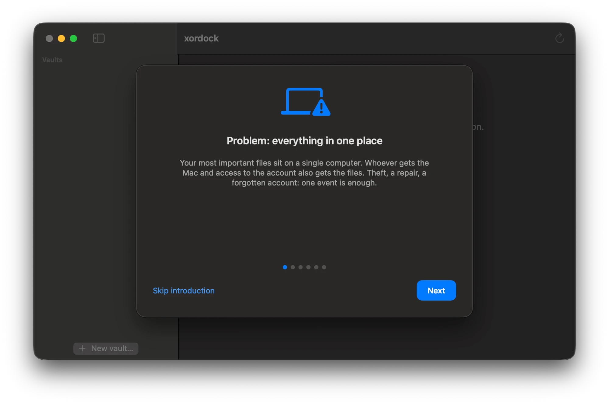 |  |
| Problem: everything in one place | Idea: two halves |
| 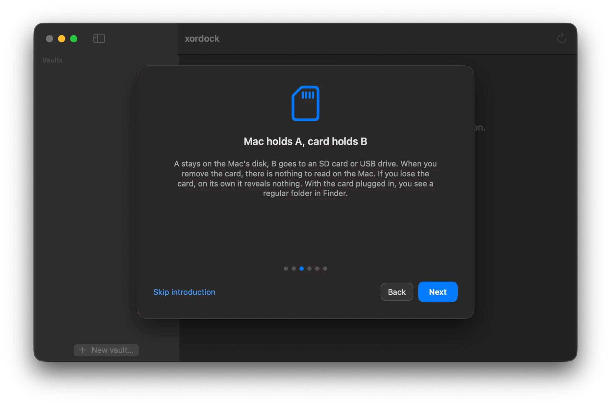 |  |
| Mac holds A, card holds B | Copies: spare card and iCloud |
| 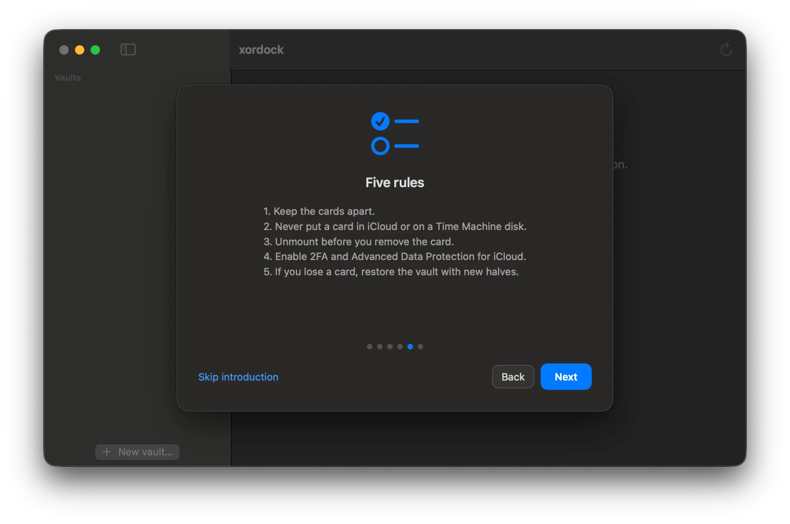 | 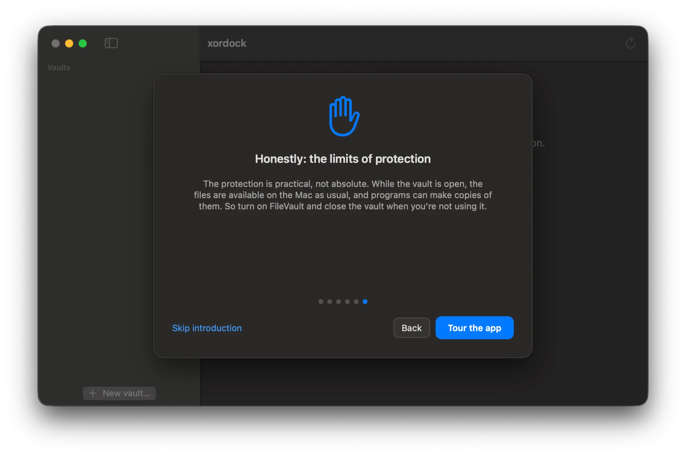 |
| Five rules | Honestly: the limits of protection |

The last screen, **Tour the app**, starts the guided walkthrough. From then on a tutorial bar at the bottom of the window shows the current step, with **Show tip**, **Back**, **Next** and **End**.

**2. Create the vault.** Plug in the working card, click **New vault…**, type a name and pick the card from the list. The sheet states plainly what you get: share A on this Mac, share B on the card, practical protection, and no access to the data without the working card.

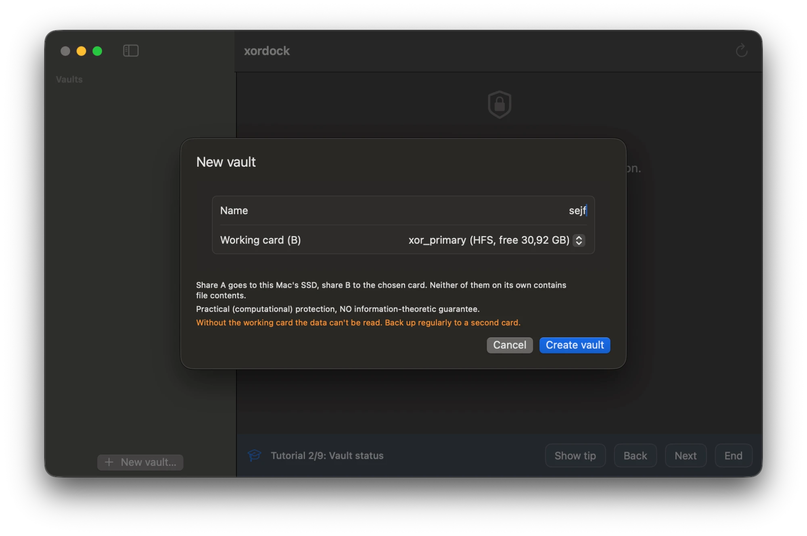

On the card, xordock writes only one folder, `xordock/<vault name>`. Everything inside it is share B, which is random noise without share A:

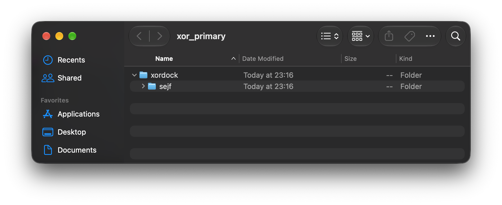

**3. Open the vault and use it.** Click **Open vault**. The vault appears in Finder as a disk named `xordock-<vault name>`. Save, edit, rename and delete files as usual; every write is split into A (Mac) and B (card) immediately.

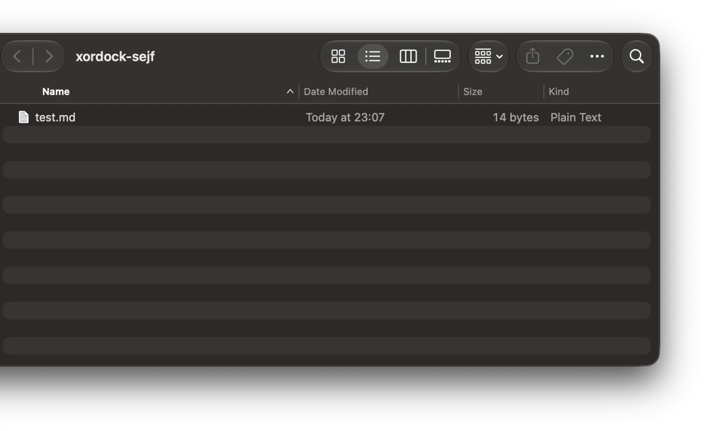

What is where while the vault is open: the card (`xor_primary`) holds only `xordock/sejf` with `obj/`, `super` and `xordock.json`, which is share B, unreadable on its own. Your file `test.md` is visible only through the mounted volume `xordock-sejf`, which xordock assembles on the fly from A and B. Eject the volume and `test.md` is gone from view; nothing readable is left on the card or on the Mac.

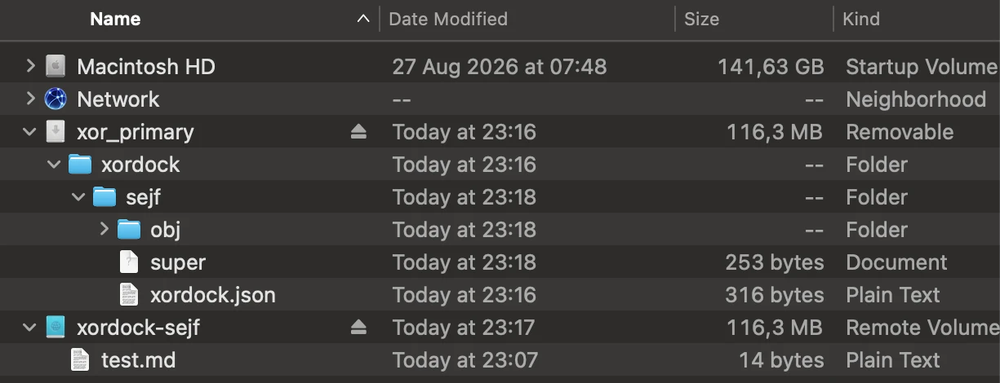

**4. Back up.** Connect the spare card as well and click **Back up now** (or **Backup…**). The spare card is preselected once it has been used. If the vault is open, the app unmounts it first, so save and close your files. Then it takes a snapshot, copies B to the spare card and A to iCloud Drive, and verifies both.

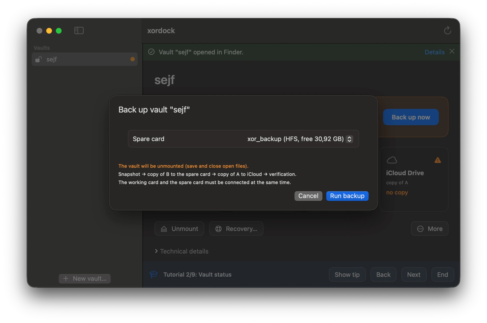

**5. All good.** The dashboard turns green when everything is in place. The four tiles show where each half is: share A on this Mac, share B on the working card, the copy of B on the spare card and the copy of A in iCloud Drive, each with the time of the last backup.

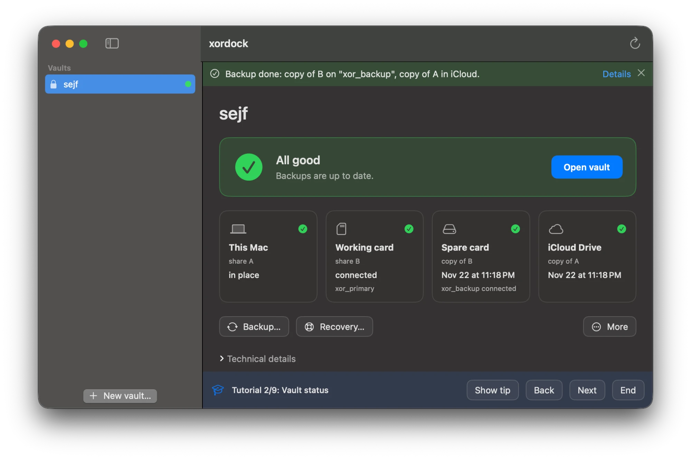

In iCloud Drive you will find `xordock/<vault name>` with the copy of share A. It is useless without a card, and it is what lets you recover after losing the Mac.

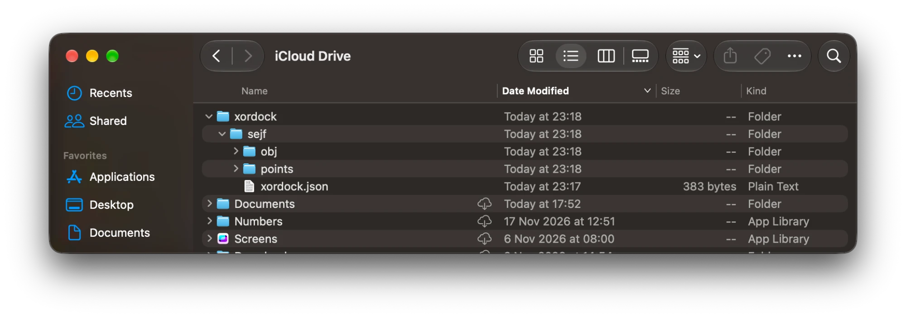

**6. What happens if you pull the card out while the vault is open.** Within about a second xordock notices that the working card is gone, locks the volume (every operation returns an I/O error, plaintext buffers are wiped) and unmounts it. The app reports an emergency unmount: changes that were not yet saved are lost, while everything committed before stays intact. Put the card back and open the vault again.

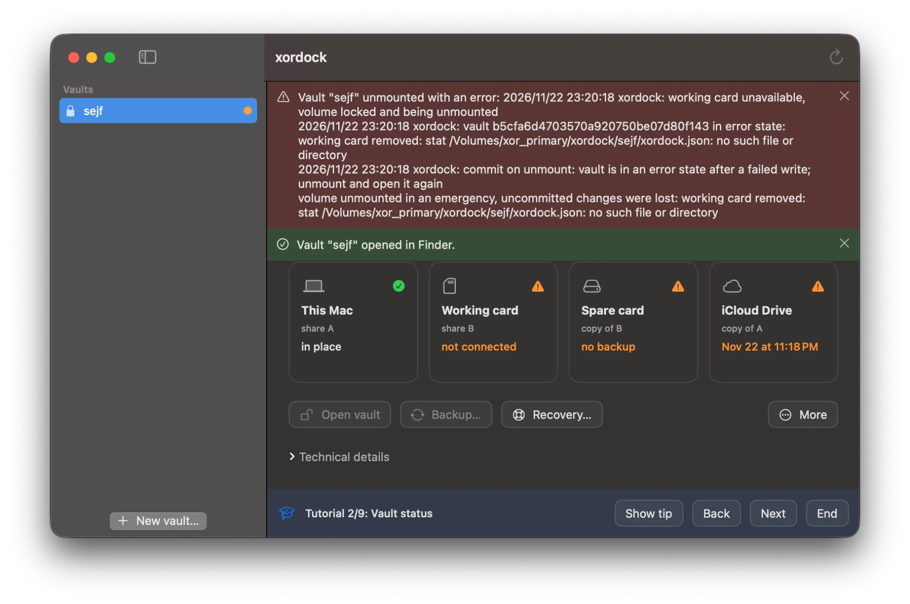

*This screenshot predates S013: the app now shows a single sentence ("The working card was removed while vault "sejf" was open…") with the log under Details, clears the "opened in Finder" banner, and shows the spare card as "unknown" instead of "no backup" while the working card is missing.*

**7. Afterwards.**

- **Unmount** before you pull the card out. Pulling it out while mounted locks the volume within about a second, and uncommitted changes are lost.
- **Back up weekly.** The padlock in the menu bar turns into a warning when a backup is due.
- **Recovery… → Verify** from time to time, to check that the backup really restores.
- Keep the two cards in different places. Never put a card's contents in iCloud or on the Time Machine disk.

### From the terminal

```bash
go build -o bin/xordock ./cmd/xordock
./bin/xordock doctor --probe-mount                               # requirements
./bin/xordock init --card /Volumes/CARD --name docs              # new vault
./bin/xordock mount --name docs                                  # until ejected / Ctrl-C
./bin/xordock snapshot create --name docs
./bin/xordock backup --name docs --spare /Volumes/SPARE          # B to the card, A to iCloud Drive
./bin/xordock recover --name docs --spare /Volumes/SPARE verify
./bin/xordock recover --from-icloud --name docs --spare /Volumes/SPARE restore --card /Volumes/NEW
```

Full list: `./bin/xordock help`. Details: [docs/usage.md](docs/usage.md), [docs/recovery.md](docs/recovery.md), [docs/threat-model.md](docs/threat-model.md), [docs/format-v1.md](docs/format-v1.md).

## Project state (2026-11-22)

**Prototype, not for production data.**

- **Works:**
  - folder in Finder (macFUSE 5.5, FSKit backend, no kext);
  - XOR split of every block and of the index with file names;
  - crash-safe A→B commit;
  - snapshots, backup to a spare card, copy of A in iCloud Drive, recovery after losing any single medium;
  - menu bar app with dashboard, tutorial and requirements check.
- **Masks:** macOS CSPRNG. Practical protection, **not** information-theoretic, **no** resistance to P = NP.
- **Known gaps:**
  - physical-disk check for A/B (S006, draft);
  - commit errors on `close` do not reach apps (R4-03);
  - no integrity against deliberate share tampering;
  - no `xattr`, symlinks or permissions;
  - no nightly 1 GiB test or fuzzing yet (S004 CP-09).
- **Performance:** about 10 MiB/s write with an SD card; limited by the card. A USB 2 stick is much slower.
- **Tested on:** macOS 27.0, Apple Silicon (M1 Pro), Go 1.27.4, Xcode 27.2, macFUSE 5.5.0.

### Architecture

| Package | Role |
| --- | --- |
| `internal/split` | `A = M ⊕ R`, `B = R`; `MaskSource` interface, today `SecRandomCopyBytes` (cgo) |
| `internal/vault` | share format v1, 1 MiB blocks, XOR-split index, A→B commit, crash recovery, GC with snapshot pins, snapshots, backup, share A copy, recovery, `fsck`, `flock` |
| `internal/fusefs` | file system operations on top of the engine; RAM write buffers; no cryptography |
| `internal/fusemount` | cgo bridge to libfuse3 (loaded with `dlopen`), card supervision, probe mount |
| `cmd/xordock` | CLI, including `doctor` and JSON queries for the app |
| `macos/` | SwiftUI app (`XordockCore`, `XordockUI`, `XordockApp`, `XordockPreview`); it never touches the shares, only runs the bundled CLI |

### Tests

```bash
go test -race ./...
(cd macos && DEVELOPER_DIR=/Applications/Xcode.app/Contents/Developer swift test)
```

Gate tests live next to the code (`*_test.go`, `macos/Tests`). E2E runs on real cards and USB sticks are recorded in the [CHANGELOG](CHANGELOG.md). Security analyses after every round: [docs/security/](docs/security/).

### How we work

[Rondo + Context-Driven-Development](https://workwithrondo.com): every change starts with a spec in `specs/` (9 sections, owner's decisions, control gates), ends with tests, a CHANGELOG entry and a security analysis. Engineering principles: [MANIFEST.md](MANIFEST.md).

| No. | Title | Status |
| --- | --- | --- |
| [S001](specs/S001-xordock-secure-folders.md) | xordock Secure Folders for macOS | superseded by S004 |
| [S002](specs/S002-integracja-bez-cache.md) | Folder in Finder via FSKit | abandoned |
| [S003](specs/S003-ochrona-katalogu-z-findera.md) | Protecting a folder from Finder | draft |
| [S004](specs/S004-xordock-macos-mvp.md) | XorDock: secure macOS folder with two shares and recovery | delivered CP-01–CP-08 (CP-08 via S007); part of CP-09 open |
| [S005](specs/S005-poprawki-bezpieczenstwa-S004.md) | Fixes from the S004 round security analysis | delivered |
| [S006](specs/S006-fizyczny-nosnik.md) | Shares A and B on different physical devices | draft (decisions gathered) |
| [S007](specs/S007-aplikacja-macos.md) | macOS app: menu bar and window | delivered; G6, G9 pending owner test |
| [S008](specs/S008-kopia-A-w-icloud.md) | Share A copy in iCloud Drive | delivered; G7 pending owner test |
| [S009](specs/S009-przejrzysty-pulpit.md) | Clear vault dashboard | delivered |
| [S010](specs/S010-samouczek.md) | Tutorial: introduction and guidance through actions | delivered; walkthrough pending owner review |
| [S011](specs/S011-sprawdzanie-wymagan.md) | Requirements check at launch | delivered |
| [S012](specs/S012-wersja-angielska.md) | English version of the project | delivered |
| [S013](specs/S013-stan-po-utracie-karty.md) | Clear state after the working card is removed | delivered |

## License

Copyright (C) 2026 Michal Sobczak

xordock is free software: you can redistribute it and/or modify it under the terms of the **GNU Affero General Public License** as published by the Free Software Foundation, either version 3 of the License, or (at your option) any later version. It is distributed in the hope that it will be useful, but WITHOUT ANY WARRANTY; without even the implied warranty of MERCHANTABILITY or FITNESS FOR A PARTICULAR PURPOSE. See [LICENSE](LICENSE) for the full text.

Third-party components are not bundled: macFUSE (and its `libfuse3`) is installed by the user and loaded at runtime under its own license; the Go standard library and Apple frameworks keep their own licenses.
