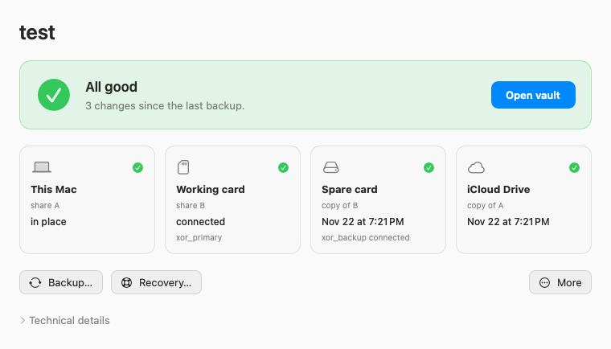

# xordock

> A macOS app that exposes an ordinary folder in Finder and stores its contents as two XOR shares: one on the Mac's internal SSD, the other on a removable SD card. Without the card the data cannot be reconstructed.

## Current state (2026-11-22)

**Prototype S004: folder in Finder, snapshots, backup to a spare card, recovery after losing the card.** Not for production data.

- Volume `/Volumes/xordock-<name>` in Finder via macFUSE 5.5 with the FSKit backend: no kext, SIP/AMFI enabled, no paid Apple account. Works: create, read, write, truncate, rename, delete, directories.
- Every block (1 MiB) and the index with file names are split with XOR: A on the SSD, B on the working card. Every write creates a new object with a new mask. Commit through A→B superblocks with crash recovery.
- Masks: **macOS CSPRNG (`SecRandomCopyBytes`)**. Practical protection, **not** information-theoretic and **no** resistance to P = NP.
- Removing the working card: the volume is locked (EIO) and unmounted within ≤ 1.25 s.
- Snapshots of xordock shares only (no APFS), backup of missing B shares to a spare card with a READY point, recovery from an A snapshot + spare card into a new vault with new masks or into a plaintext export.
- **Share A copy in iCloud Drive** (S008) on every backup. You can lose the SSD, the working card or the spare card, one at a time.
- **App** `xordock.app` (S007): menu bar icon and a window for creating a vault, mounting, backup and recovery, no terminal needed.
- Known gap (S006, draft): the "A and B on different media" check compares volumes, not physical disks. A disk image or a second partition on the same disk passes.
- Missing: the nightly 1 GiB test and fuzzing (CP-09), file permissions, `xattr`, symlinks, password, detection of deliberate share substitution. Open finding R4-03: a commit error on `close` does not reach the application (macFUSE/FSKit).
- Performance (SSD + HFS+ SD card, through Finder): write ~10 MiB/s, small file ~220 ms.
- Test environment: macOS 27.0, Apple Silicon, Go 1.27.4, Xcode 27.2, macFUSE 5.5.0 (libfuse3 3.18.3).

## Usage

### App

```bash
./scripts/build-app.sh
open build/xordock.app
```



At startup the app checks the requirements (macOS 26+, macFUSE 5.5+, enabled extension, FileVault, iCloud Drive) and, if anything is missing, shows what to fix. The same from the terminal: `./bin/xordock doctor --probe-mount`. It then offers a tutorial: a few screens on how the protection works, followed by a walkthrough of creating a vault, opening it and backing up, with callouts next to the buttons. You can turn the prompt off in Settings (⌘,).

A padlock icon appears in the menu bar, and "Open xordock…" opens the window. The A files belong to you, so do not run anything with `sudo`.

### CLI

Required: macFUSE 5.5+ (`brew install --cask macfuse`, installed by the user; xordock does not bundle it, see the macFUSE license) and the extension enabled in System Settings → General → Login Items & Extensions → File System Extensions.

```bash
go build -o bin/xordock ./cmd/xordock
./bin/xordock init --card /Volumes/xordock --name sejf
./bin/xordock mount --name sejf            # until ejected in Finder / Ctrl-C
./bin/xordock status --name sejf
./bin/xordock snapshot create --name sejf
./bin/xordock backup --name sejf --spare /Volumes/ZAPAS   # + copy of A to iCloud Drive
./bin/xordock recover --name sejf --spare /Volumes/ZAPAS restore --card /Volumes/NOWA
```

Full list: `xordock help`. Rules: [docs/usage.md](docs/usage.md), backup and recovery: [docs/recovery.md](docs/recovery.md), format: [docs/format-v1.md](docs/format-v1.md), threat model: [docs/threat-model.md](docs/threat-model.md).

## Architecture

| Package | Role |
| --- | --- |
| `internal/split` | `A = M ⊕ R`, `B = R`; masks from `SecRandomCopyBytes` (cgo) |
| `internal/vault` | share format v1, 1 MiB blocks, XOR-split index, A→B commit, crash recovery, GC with snapshot pins, snapshots, backup to a spare card, recovery, `fsck`, `flock` |
| `internal/fusefs` | file system operations on top of the engine: write buffers in RAM, commit on close/fsync, unavailable state after card removal; no cryptography |
| `internal/fusemount` | cgo bridge to libfuse3 from macFUSE (`backend=fskit`), card supervision, unmount |
| `cmd/xordock` | CLI; `vaults`/`volumes`/`points` output JSON for the app |
| `macos/` | SwiftUI app: `XordockCore` (model, CLI invocation, status rules), `XordockUI` (dashboard), `XordockApp` (menu bar, window, sheets), `XordockPreview` (renders the dashboard to PNG); no access to the shares |

Dependencies: Go standard library, cgo to Security.framework and libfuse3 (macFUSE).

## Tests

```bash
go test -race ./...
(cd macos && DEVELOPER_DIR=/Applications/Xcode.app/Contents/Developer swift test)
```

Tests for the S004 gates CG-01–CG-12 are in `internal/*/…_test.go` (mapping: S004 §9 "Gates and evidence"). E2E on the SD card and on disk images is described in the CHANGELOG. Engine measurements: `XORDOCK_PERF_A=<directory on SSD> XORDOCK_PERF_B=<directory on card> go test -run TestPerf -v ./internal/vault`.

## How we work

Methodology [Rondo + Context-Driven-Development](https://workwithrondo.com):

| Artifact | Role |
| --- | --- |
| `specs/` | intent: goal, scope, rules and gates of every change |
| `CHANGELOG.md` | what was actually delivered |
| tests (`*_test.go`) | evidence for what the CHANGELOG describes |
| `README.md` | the "here and now" state |
| `MANIFEST.md` | the project's engineering principles |
| `docs/security/` | security analyses after every round (latest: round S008) |

## Specs

| No. | Title | Status |
| --- | --- | --- |
| [S001](specs/S001-xordock-secure-folders.md) | xordock Secure Folders for macOS | superseded by S004 |
| [S002](specs/S002-integracja-bez-cache.md) | Folder in Finder via FSKit | abandoned |
| [S003](specs/S003-ochrona-katalogu-z-findera.md) | Protecting a folder from Finder | draft |
| [S004](specs/S004-xordock-macos-mvp.md) | XorDock: secure macOS folder with two shares and recovery | delivered CP-01–CP-08 (CP-08 via S007); part of CP-09 open |
| [S005](specs/S005-poprawki-bezpieczenstwa-S004.md) | Fixes from the S004 round security analysis | delivered |
| [S006](specs/S006-fizyczny-nosnik.md) | Shares A and B on different physical devices | draft (decisions gathered) |
| [S007](specs/S007-aplikacja-macos.md) | macOS app: menu bar and window | delivered; G6, G9 pending owner test |
| [S008](specs/S008-kopia-A-w-icloud.md) | Share A copy in iCloud Drive | delivered; G7 pending owner test |
| [S009](specs/S009-przejrzysty-pulpit.md) | Clear vault dashboard | delivered |
| [S010](specs/S010-samouczek.md) | Tutorial: introduction and guidance through actions | delivered; walkthrough pending owner review |
| [S011](specs/S011-sprawdzanie-wymagan.md) | Requirements check at launch | delivered |
| [S012](specs/S012-wersja-angielska.md) | English version of the project | delivered |
